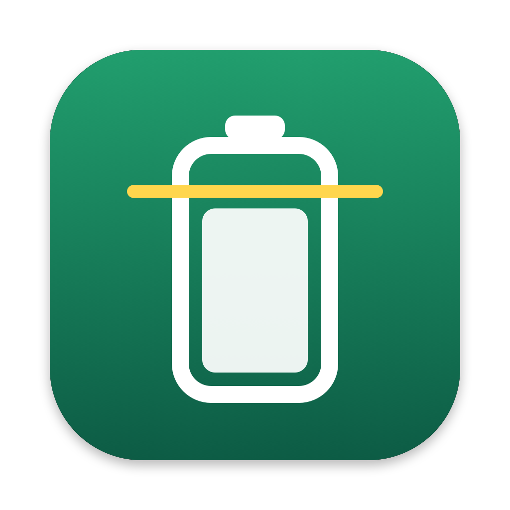

# Plafond

Limiteur de charge pour MacBook, logé dans la barre de menus, écrit de zéro.
Testé sur MacBook Air M4, macOS 27.0.1.



## Ce que fait Plafond

| Fonction | Comment | Assistant root requis ? |
|---|---|---|
| Limite de charge 80, 85, 90, 95 ou 100 % | limite native de macOS (PowerUI, `setMCLLimit:`). Elle tient même app fermée. | non |
| 100 % une fois | `temporarilyDisableMCL:` ; la limite revient d'elle-même | non |
| État, santé, cycles, température, historique 12 h | IORegistry `AppleSmartBattery` (rafraîchi par macOS toutes les 60 s) | non |
| Flux d'énergie en direct (panneau ouvert, 1 s) | SMC `PDTR` (entrée), `PSTR` (Mac), `B0AV`×`B0AC` (batterie), `TB0T` | non |
| Décharge forcée jusqu'à la limite (Mac branché) | coupure de l'adaptateur, clé SMC `CHIE` = `0x08` | **oui** |
| LED MagSafe (système, éteinte, intelligente) | clé SMC `ACLC` | **oui** |
| Limite sous 80 % (expérimental) | coupure cyclique de l'adaptateur + plancher natif à 80 % | **oui** |
| Ligne de commande | `plafondctl` | selon la commande |

Pourquoi « sous 80 % » est expérimental : sur macOS 27, le firmware n'expose
plus les clés qui suspendaient la charge (`CHTE`, `CH0B/CH0C`). La seule
coupure possible est celle de l'adaptateur. La batterie redescend donc de
quelques % (réglable) avant de recharger, ce qui fait des micro-cycles.

## Arborescence

```
Sources/Shared/   SMC.swift (accès AppleSMC), Battery.swift (IORegistry), HelperProtocol.swift (contrat XPC)
Sources/Helper/   main.swift : démon root, boucle de décision, veille, SIGTERM
Sources/App/      app SwiftUI MenuBarExtra (modèle, PowerUI, client XPC, vues, icône dynamique)
Tools/            smcprobe (sonde SMC), plafondctl (CLI), make_icon (génère l'icône)
Resources/        helper-install.sh (installation root), AppIcon.icns
build.sh          compile, empaquette, signe et vérifie
```

## Construire

```bash
./build.sh
```

Il faut seulement les Command Line Tools (Swift 6.4). La première fois, crée
une identité de signature locale (certificat auto-signé dans un trousseau
dédié, mot de passe aléatoire enregistré dans `.signing.env`, non versionné) :

```bash
./Tools/setup_signing.sh
```

Le helper n'accepte que les clients signés par ce certificat précis, épinglé par
son empreinte SHA-1 au moment du build.

Particularité du SDK macOS 27 : `@State` y est une macro dont le plugin
n'est livré qu'avec Xcode. Le code utilise donc `@StateObject` à la place.

## Lancer

```bash
open build/Plafond.app
```

L'app **n'écrit rien au démarrage** : elle lit l'état puis attend une action.

**Avant toute chose, quitte tout autre limiteur de charge** et retire-le des
éléments de connexion, sinon les deux outils se battent pour la même limite.

## Installer l'assistant privilégié (facultatif)

Dans Plafond, ouvre **Réglages** puis **Installer…**. macOS demande ton mot de
passe administrateur, puis le script `helper-install.sh` :

1. vérifie que le helper est signé par notre certificat ;
2. le copie dans `/Library/PrivilegedHelperTools/com.polat.plafond.helper` ;
3. crée `/Library/LaunchDaemons/com.polat.plafond.helper.plist` et le démarre.

Équivalent en terminal :

```bash
sudo build/Plafond.app/Contents/Resources/helper-install.sh install "$PWD/build/Plafond.app"
```

Désinstallation (rétablit l'adaptateur et la LED avant de partir) : bouton
**Désinstaller** dans les Réglages, ou :

```bash
sudo build/Plafond.app/Contents/Resources/helper-install.sh uninstall
```

## Ligne de commande

```bash
build/Plafond.app/Contents/MacOS/plafondctl status
```

Autres commandes : `limit 80|…|100|off`, `topup`, `discharge <N>|off`,
`softlimit <N>|off`, `led system|off|smart`.

## Garde-fous du helper

- Il n'écrit que sur une liste blanche de clés (`CHIE`, `CH0I`, `CHTE`,
  `CH0B/C`, `ACLC`), à partir d'une politique de haut niveau. Il n'existe aucune
  primitive « écrire telle clé ».
- Il rétablit l'adaptateur avant chaque mise en veille, quand le câble est
  débranché, et sous 10 % de batterie.
- Sur SIGTERM (désinstallation, mise à jour, arrêt), il remet adaptateur, charge
  et LED dans l'état attendu par le firmware.
- La validation XPC est mutuelle : l'app vérifie le helper, le helper vérifie
  l'app et `plafondctl`. Un client ad hoc qui usurpe l'identifiant est refusé
  (testé).
- Il re-vérifie l'état toutes les 20 s, à chaque événement d'alimentation et au
  réveil.

## Journal

```bash
log stream --predicate 'subsystem == "com.polat.plafond.helper"'
```
